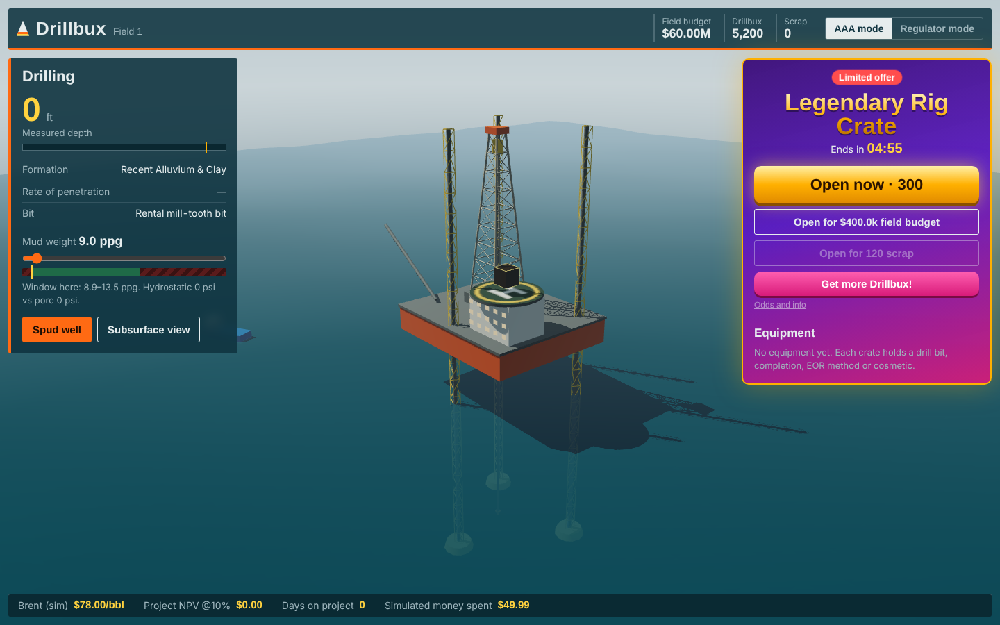
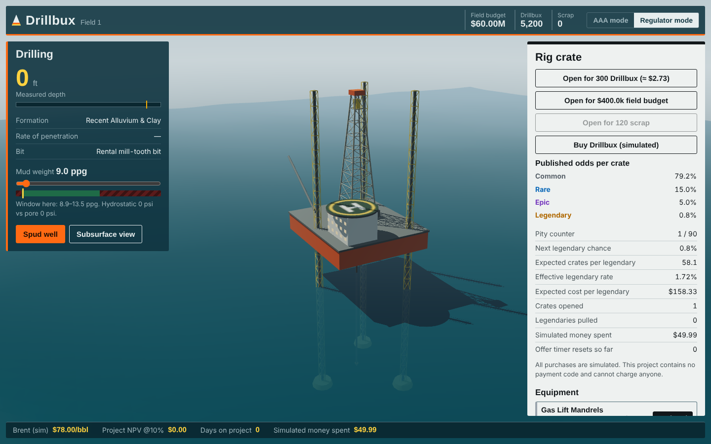

# Drillbux

**A satirical AAA microtransaction simulator, built on real petroleum engineering.**

Drill an offshore well in 3D, survive a kick, put it on production, and watch the crate store try to take your money — then flip one switch and see exactly how it was doing it.



**Play:** [kendrewflor.github.io/drillbux](https://kendrewflor.github.io/drillbux/)

## What you do

1. **Drill.** Spud an 8,000 ft well through five formations. Manage mud weight inside the pore/fracture-pressure window. Go too light and you take a kick and have to circulate kill mud (with the real IWCF equation on screen); too heavy and you lose circulation.
2. **Complete.** Review the reservoir you hit: porosity, saturation, permeability, OOIP. Choose your completion.
3. **Produce.** Rate comes from radial Darcy inflow and declines along an Arps curve. Oil price wanders; project NPV updates daily at a 10% discount rate.
4. **Get monetized.** Crates hold drill bits (faster ROP), completions (lower skin), EOR methods (higher recovery factor) and cosmetics (nothing at all).

## Two modes, one store

| AAA mode | Regulator mode |
|---|---|
| Hidden odds behind a faint link | Published odds table and live pity counter |
| A "limited offer" countdown | The same countdown, with how many times it has silently reset |
| Prices in Drillbux only | Every price converted to dollars, plus the expected cost per legendary |
| A legendary flashes before every non-legendary result | An explanation of why that "near miss" was never a possible outcome |
| Bundle sizes that strand leftover currency | The cheapest bundle combination and exactly how much is stranded |



**All purchases are simulated.** There is no payment code anywhere in this game I made.

## The engineering

| Model | Equation |
|---|---|
| Hydrostatic pressure | $P_h = 0.052 \cdot MW \cdot TVD$ |
| Kill mud weight (IWCF) | $KMW = OMW + \dfrac{SIDPP}{0.052 \cdot TVD}$ |
| Volumetric OOIP | $N = \dfrac{7758\,A\,h\,\phi\,(1-S_w)}{B_o}$ |
| Radial inflow (PSS Darcy) | $q_o = \dfrac{0.00708\,k\,h\,(\bar P_r - P_{wf})}{\mu_o B_o\,[\ln(r_e/r_w) - 0.75 + s]}$ |
| Arps decline | $q(t) = q_i\,(1 + b D_i t)^{-1/b}$ |
| NPV | $\sum_t CF_t\,/\,(1 + i_d)^t$ |

Derivations, assumptions and parameter ranges: [docs/PETROLEUM_MODEL.md](docs/PETROLEUM_MODEL.md).

## Run it locally

No install step. Requires Node 20+ for the dev server and checks; the game itself is plain static files.

```sh
npm start          # http://127.0.0.1:5173
npm test           # 23 unit tests (physics, crate odds, game loop, save validation)
npm run check      # vendor checksums + security scan + tests
```

Controls: drag to orbit, scroll or pinch to zoom.

## Security

This repo is built to be safe to clone, safe to open in an AI coding agent, and safe to visit:

- **Zero dependencies**, with no install scripts. Three.js is vendored from its official tag and pinned by SHA-256.
- **Strict CSP**: same-origin scripts only, no network access, no inline code.
- **SHA-pinned GitHub Actions** with read-only tokens; CodeQL on every push.
- **Prompt-injection scanning**: hidden Unicode, Trojan Source characters, agent config files, hidden Markdown comments and injection phrases fail CI.
- **Untrusted save data** is schema-validated; crate rolls can't be edited in through local storage.

Details: [SECURITY.md](SECURITY.md) and [docs/THREAT_MODEL.md](docs/THREAT_MODEL.md). If you use AI coding tools with this repo, read [docs/AI_TOOLING.md](docs/AI_TOOLING.md) first.

## Deploy to GitHub Pages

Settings → Pages → Source: **GitHub Actions**. Every push to `main` runs the checks, then publishes only `index.html`, `src/` and `vendor/`.

## Project layout

```
index.html            entry point and CSP
src/
  reservoir.js        petroleum engineering (pure functions)
  economy.js          crate odds, pity, bundles (pure functions)
  game.js             state and simulation tick, save validation
  scene.js            Three.js rig, ocean, subsurface cutaway, crate effects
  main.js             UI and game loop
  dom.js              injection-safe DOM builder
  rng.js              seeded PRNG (sfc32)
vendor/three/         Three.js r186, checksummed
scripts/              dev server, vendor verifier, security scanner
tests/                node:test suites
.githooks/commit-msg  strips AI co-author trailers
```

## License

MIT © 2026 Kendrew Flor S. Arrabe. Three.js is MIT © Three.js authors.
